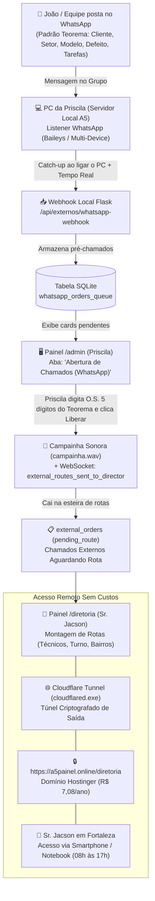

# PLANEJAMENTO DE INTEGRAÇÃO DE PONTA A PONTA
## Captação WhatsApp • Triagem Recepção (Priscila) • Despacho Diretoria (Sr. Jacson) • Cloudflare Tunnel (`a5painel.online`)

> **DOCUMENTO MESTRE DE ARQUITETURA E EXECUÇÃO**  
> Este documento descreve o fluxo completo de implementação para conectar os chamados externos enviados no grupo do WhatsApp da **A5 Tecnologia** até a tela do **Sr. Jacson** em Fortaleza, operando no domínio próprio **`a5painel.online`** com **custo zero de mensalidade de nuvem** e sem expor portas do roteador.

---

## 1. VISÃO GERAL E FLUXO DO SISTEMA



---

## 2. ETAPA 1: ESTRUTURAÇÃO DAS MENSAGENS NO GRUPO DO WHATSAPP

Para manter compatibilidade perfeita com o analisador de O.S. já desenvolvido e testado no sistema (`kanban/services/externos.py`), as mensagens no grupo de WhatsApp seguirão o formato amigável padrão:

```text
*NOVO CHAMADO EXTERNO*
Cliente: Supermercado Baratão da Carne
Setor: Açougue
Equipamento: Balança Toledo Prix 5 Plus
Defeito: Teclado travado, não emite etiqueta de peso
Tarefas / Obs: Trocar cabeça térmica e limpar balança. Levar fita teste.
```

### Regras do Parser Inteligente (Python):
1. **Cliente:** Extrai a linha iniciada por `Cliente:` ou `Supermercado / Drogaria / Frigorífico`.
2. **Setor:** Extrai o setor (Açougue, Rotisserie, Recebimento, Padaria, Frente de Caixa, etc.).
3. **Equipamento:** Reconhece modelos Toledo (Prix 4, Prix 5, Prix 6, 8217, 2090, PL 150) e outras marcas.
4. **Defeito:** Identifica a descrição da anomalia relatada pelo cliente.
5. **Tarefas:** Observações operacionais para o técnico que irá a campo.

---

## 3. ETAPA 2: LISTENER DO WHATSAPP NO COMPUTADOR DA PRISCILA

### Por que rodar na máquina da Priscila?
- O computador da Priscila é onde o servidor Flask da A5 já roda localmente.
- O WhatsApp Web oficial da empresa já permanece aberto no navegador dela durante todo o expediente.
- O consumo de mensagens ocorre 100% em rede local (`localhost:5000`), sem necessidade de expor APIs públicas com chaves pagas da Meta.

### Arquitetura do Listener (Microserviço Baileys em Node.js - Recomendado):
1. **Tecnologia:** `@whiskeysockets/baileys` (biblioteca leve em Node.js que emula uma sessão oficial do WhatsApp Multi-Device).
2. **Conexão:** É pareado **uma única vez** como "Aparelho Conectado" no WhatsApp da empresa escaneando um QR Code no terminal.
3. **Segurança e Estabilidade:** 
   - Não dispara envios em massa (apenas escuta mensagens recebidas).
   - Usa o protocolo oficial de sincronização multi-dispositivo da Meta (zero risco de banimento de conta).
4. **Filtro Estrito:**
   - O listener só processa mensagens cujo `remoteJid` seja o ID exato do grupo de chamados da A5 (`id_do_grupo@g.us`).
   - Mensagens privadas de clientes, fornecedores e conversas pessoais são **completamente ignoradas**.

---

## 4. ETAPA 3: SINCRONIZAÇÃO E "CATCH-UP ON BOOT" (SEGUNDA-FEIRA / PÓS-EXPEDIENTE)

### O Desafio da Operação Real:
- O computador da Priscila é desligado rigorosamente às **17:00** e permanece desligado durante todo o final de semana.
- Clientes ou gestores podem postar chamados no grupo na sexta-feira à noite, no sábado ou no domingo.

### Solução Técnica Implementada:
1. **Persistência na Nuvem do WhatsApp:** Todas as mensagens postadas com o PC desligado continuam armazenadas de forma segura nos servidores da Meta.
2. **Sincronização no Boot:**
   - Assim que a Priscila liga o PC na segunda-feira às 08:00, o serviço inicia automaticamente (via atalho na pasta `Inicializar` do Windows).
   - O Baileys solicita o histórico de mensagens pendentes/não lidas do grupo das últimas 72 horas.
3. **Deduplicação por ID Único:**
   - Cada mensagem do WhatsApp possui um identificador global exclusivo (`message.key.id`, ex: `3EB09F8C721A...`).
   - O banco de dados SQLite armazena esse ID com restrição `UNIQUE`. Mensagens já processadas são ignoradas, evitando chamados duplicados.

---

## 5. ETAPA 4: TRIAGEM NA RECEPÇÃO (`/admin` - ABERTURA DE CHAMADOS WHATSAPP)

### Fluxo Operacional da Priscila:
1. Priscila abre a tela `/admin` no seu navegador.
2. Uma nova seção destacada chamada **"Abertura de Chamados (WhatsApp)"** exibe os cards que chegaram automaticamente do grupo.
3. Cada card já vem preenchido:
   - **Cliente:** Supermercado Baratão da Carne
   - **Setor:** Açougue
   - **Equipamento:** Prix 5 Plus
   - **Defeito:** Teclado travado
   - **Campo Vazio:** `[ O.S. Teorema: _____ ]`
4. Priscila abre o Teorema ERP, gera o número da O.S. oficial (5 dígitos, ex: `26815`) e digita no campo do card.
5. Priscila clica em **"Liberar para Rota"**:
   - O sistema valida os 5 dígitos.
   - O card é movido da fila provisória para a tabela principal `external_orders` com `attendance_status = 'pending'` e `technician = None` (Aguardando Rota).
   - Toca a **campainha sonora** (`campainha.wav`).
   - É disparado um evento WebSocket `external_routes_sent_to_director` que faz o chamado aparecer instantaneamente na tela do Sr. Jacson!

---

## 6. ETAPA 5: DOMÍNIO HOSTINGER (`a5painel.online`) + CLOUDFLARE TUNNEL

### Visão Geral de Custos e Conexão:
- **Domínio Próprio Adquirido:** `a5painel.online` na Hostinger por **R$ 7,08 / ano**.
- **Custo Mensal de Servidor em Nuvem:** **R$ 0,00** (economia total, sem necessidade de servidores caros na AWS, Google Cloud ou Oracle).
- **Sem Port Forwarding:** Não é necessário mexer no modem da empresa, não precisa abrir portas (Port 80/443) e não precisa de IP fixo da operadora.

### Como Funciona o Cloudflare Tunnel:
1. **O Agente Local (`cloudflared.exe`):**
   - É um binário oficial e seguro da Cloudflare (~30 MB) que roda como serviço silencioso no Windows da Priscila.
   - Ele cria um túnel de saída criptografado (outbound HTTPS) diretamente para os data centers da Cloudflare.
   - Conecta o tráfego externo para `http://localhost:5000` do Flask.
2. **Configuração DNS na Hostinger & Cloudflare:**
   - Adiciona-se o domínio `a5painel.online` na conta gratuita da Cloudflare.
   - Na Hostinger, troca-se apenas os Nameservers para os fornecidos pela Cloudflare (ex: `ns1.cloudflare.com` e `ns2.cloudflare.com`).
   - Na Cloudflare, cria-se o túnel apontando para o hostname `a5painel.online` -> `http://localhost:5000`.
3. **Certificado SSL / HTTPS:**
   - O tráfego para `https://a5painel.online/diretoria` recebe certificado digital TLS/SSL de 256 bits gerado automaticamente pela Cloudflare.
4. **Alinhamento com o Horário de Expediente:**
   - O Sr. Jacson em Fortaleza precisa ver e despachar rotas durante o horário comercial (08:00 às 17:00).
   - Como o computador da Priscila fica ligado exatamente nesse intervalo, o túnel fica ativo precisamente nas horas em que o sistema é demandado.

---

## 7. COMO COMPARTILHAR ESTE CONHECIMENTO COM O ANTIGRAVITY NO TRABALHO

> **COMO O ANTIGRAVITY SINCRONIZA O CONHECIMENTO ENTRE COMPUTADORES?**  
> O Antigravity não depende de memória em nuvem isolada. Ele lê diretamente a **árvore de arquivos e a documentação do repositório Git**.  
> Qualquer instrução, decisão técnica ou especificação documentada em arquivos `.md` (como este `PLANEJAMENTO_INTEGRACAO.md` e a `KNOWLEDGE_BASE.md`) é lida e absorvida instantaneamente pelo Antigravity em qualquer máquina assim que o repositório é clonado ou atualizado.

### Passo a Passo ao Chegar no Computador do Trabalho:

1. **Abra o terminal do projeto no trabalho e execute:**
   ```bash
   git pull origin main
   ```
   *Isso baixará este arquivo, todos os códigos e o histórico mais recente de alterações.*

2. **Abra o Antigravity no computador de trabalho e envie a mensagem:**
   > *"Olá! Já baixei as últimas atualizações do Git. Leia o arquivo `PLANEJAMENTO_INTEGRACAO.md` e a `KNOWLEDGE_BASE.md`. Vamos dar continuidade ao projeto a partir da [Etapa que desejar, ex: Etapa 2 - Listener do WhatsApp / Etapa 5 - Configuração do Cloudflare Tunnel]."*

3. **O Antigravity daquela máquina irá imediatamente:**
   - Ler este documento de ponta a ponta.
   - Reconhecer as tabelas do banco, os endpoints Flask, o domínio `a5painel.online` e as regras de negócio de Manaus.
   - Continuar a implementação exatamente de onde paramos, com autoridade e sem você precisar reexplicar absolutamente nada!

---

## 8. PLANO DE AÇÃO DETALHADO POR ETAPAS

| Etapa | Tarefa Técnica | Arquivos Envolvidos | Status |
|:---|:---|:---|:---|
| **1** | Sintetizador de campainha e notificação visual de não atendido | `static/sounds/campainha.wav`, `templates/admin.html`, `templates/diretoria.html`, `kanban/database.py` | Concluído |
| **2** | Tabela `whatsapp_orders_queue` e migração no SQLite | `kanban/database.py` | A Iniciar |
| **3** | Endpoint do Webhook e Parser de Mensagens | `kanban/services/externos.py`, `kanban/routes/externos.py` | A Iniciar |
| **4** | Microserviço Listener WhatsApp (Baileys) | `services/whatsapp_listener/` | A Iniciar |
| **5** | Tela de Triagem da Priscila (Abertura WhatsApp com O.S. Teorema) | `templates/admin.html`, `templates/externos_whatsapp.html` | A Iniciar |
| **6** | Configuração do Cloudflare Tunnel com o domínio `a5painel.online` | `cloudflared`, DNS Hostinger / Cloudflare | A Iniciar |
| **7** | Validação de Acesso Externo da Diretoria em Fortaleza | Teste via smartphone em `https://a5painel.online/diretoria` | A Iniciar |

---
*Documento compilado e registrado no repositório oficial da A5 Tecnologia pelo Antigravity.*
