# ⚖️ A5 Tecnologia — Esteira de Produção, Kanban Inteligente & Gestão de Rotas

Sistema web local de gerenciamento e automação da oficina de manutenção de balanças (**Toledo Prix** e linha industrial) e gestão de **Chamados Externos (Rotas de Rua)** da **A5 Tecnologia**.

Integra leitura automática de Ordens de Serviço em PDF geradas pelo **Teorema ERP**, controle de fluxo de bancada por **QR Code no celular**, etiquetas inteligentes com **notificações discretas na TV**, anúncios por voz (**Edge-TTS**) com *audio ducking*, **Triagem e Geração de Cards WhatsApp de Rotas Externas** e **Backup/Sincronização em Nuvem via GitHub**.

---

## 🧭 Fluxograma da Esteira de Produção & Regras de Etiquetas

O ciclo de vida da balança na oficina é controlado automaticamente pelo QR Code na bancada e pelas ações da recepção (Priscila):

```mermaid
flowchart TD
    PDF["📄 PDF da O.S. (Teorema ERP)<br/>Salvo em ./entrada_pdfs/"] --> WATCHDOG["🤖 Monitor Background (Watchdog)<br/>Extrai O.S., Cliente Fantasia, Modelo e Defeito"]
    
    WATCHDOG --> DB_INSERT["📥 Coluna: ORÇAMENTOS (Topo)<br/>Etiquetas permitidas: URGÊNCIA e EM GARANTIA<br/>(Clique dispara aviso discreto na TV)"]
    
    DB_INSERT --> LABEL_PRINT["🏷️ Etiqueta Térmica 60x40mm<br/>Impressão automática na Recepção com QR Code"]
    
    LABEL_PRINT --> SCAN1["📱 1º SCAN QR CODE (Bancada)<br/>Técnico puxa balança para diagnóstico"]
    
    SCAN1 --> TECH_ORC["🔬 FASE: EM_ORCAMENTO (Coluna do Técnico)<br/>TV: Crachá 'ORÇAMENTANDO'<br/>Libera demais etiquetas (Aguardando, etc.)"]
    
    TECH_ORC --> SCAN2["📱 2º SCAN QR CODE (Fim do Laudo)<br/>Técnico informa peças/serviço e conclui"]
    
    SCAN2 --> ORC_FEITOS["📋 Coluna: ORÇAMENTOS FEITOS<br/>Calcula tempo líquido de diagnóstico<br/>Notifica Recepção"]
    
    ORC_FEITOS --> ADM_ENVIA["📤 Coluna: ORÇAMENTOS ENVIADOS<br/>Recepção envia orçamento ao cliente<br/>(Tempo líquido pausado aguardando resposta)"]
    
    ADM_ENVIA --> DECISAO{"Decisão do Cliente"}
    
    DECISAO -- "Recusado" --> NAO_AUT["🚫 Coluna: NÃO AUTORIZADOS<br/>Montagem da balança p/ devolução"]
    DECISAO -- "Aprovado" --> ADM_APROVA["✅ Coluna: APROVADOS<br/>Limpa tags antigas (mantém só URGÊNCIA / GARANTIA)<br/>Libera tag 'FALTA PEÇA' + Voz na TV"]
    
    ADM_APROVA --> PECA_CHECK{"Tem todas as peças?"}
    
    PECA_CHECK -- "Falta Peça" --> BAL_PEND["📦 Coluna: BALANÇAS PENDENTES<br/>(Oculta na TV da oficina)<br/>Aguarda chegada da peça sem poluir a TV"]
    BAL_PEND -- "Peça chegou" --> SCAN3
    PECA_CHECK -- "Peças OK" --> SCAN3["📱 3º SCAN QR CODE / Arrastar p/ Técnico<br/>Início da Manutenção"]
    
    SCAN3 --> TECH_MANUT["🔧 FASE: EM_MANUTENCAO<br/>TV: Crachá 'FINALIZANDO BALANÇA'"]
    
    TECH_MANUT --> SCAN4["📱 4º SCAN QR CODE (Conclusão)<br/>Técnico finaliza reparo e calibração"]
    
    SCAN4 --> FINALIZADAS["🏁 Coluna: FINALIZADAS<br/>Calcula Tempo Líquido Total<br/>Atualiza Relatório da Diretoria (/diretoria)"]

    classDef pdfStyle fill:#0284c7,stroke:#0369a1,stroke-width:2px,color:#fff;
    classDef scanStyle fill:#f59e0b,stroke:#d97706,stroke-width:2px,color:#fff;
    classDef techStyle fill:#3b82f6,stroke:#1d4ed8,stroke-width:2px,color:#fff;
    classDef admStyle fill:#8b5cf6,stroke:#6d28d9,stroke-width:2px,color:#fff;
    classDef pendStyle fill:#ea580c,stroke:#c2410c,stroke-width:2px,color:#fff;
    classDef okStyle fill:#10b981,stroke:#047857,stroke-width:2px,color:#fff;

    class PDF,WATCHDOG,DB_INSERT,LABEL_PRINT pdfStyle;
    class SCAN1,SCAN2,SCAN3,SCAN4 scanStyle;
    class TECH_ORC,TECH_MANUT techStyle;
    class ORC_FEITOS,ADM_ENVIA,ADM_APROVA,NAO_AUT admStyle;
    class BAL_PEND pendStyle;
    class FINALIZADAS okStyle;
```



---

## 🚀 Principais Módulos e Recursos

### 1. Quadro Kanban da Recepção (`/admin` — Priscila)
* **Navegação Rápida e Ergonômica**:
  * **Arrastar a Tela (`Click & Drag` Horizontal)**: clique e segure em qualquer espaço livre do fundo ou entre cartões para deslizar a tela para um lado e para o outro com facilidade.
  * **Fechar Card Clicando Fora (`Backdrop Click`)**: ao abrir qualquer card, basta clicar fora dele (no fundo escurecido) ou apertar `ESC` para fechar imediatamente, sem precisar mirar no `X`.
  * **Seletor de Estágio / Lista Dentro do Card**: dentro do modal de cada O.S., o seletor **"Mudar Estágio / Coluna da Balança"** permite transferir o equipamento para qualquer lista com 1 clique.
* **Sistema Inteligente de Etiquetas (Tags) por Fase**:
  1. **Fase `ORÇAMENTOS`**: exibe exclusivamente as opções **🚨 URGÊNCIA** e **🛡️ EM GARANTIA**. Ao marcar qualquer uma delas, o sistema envia uma **notificação discreta (mini-toast de 6s)** no canto superior direito da TV da oficina.
  2. **Fora de `ORÇAMENTOS` (Bancada, Orçamentos Feitos, Enviados)**: libera todas as demais opções (`⏳ AGUARDANDO`, `📦 FALTA PEÇA`, `💬 AGUARDANDO CLIENTE`, etc.) e o botão `+ Nova` para criar etiquetas personalizadas.
  3. **Na Aprovação (`APROVADOS`)**: o sistema **remove automaticamente etiquetas temporárias anteriores** (como *Aguardando*), **mantendo estritamente `URGÊNCIA` e `EM GARANTIA`** caso já estivessem marcadas, e destaca a opção **📦 FALTA PEÇA**.
  4. **Coluna `BALANÇAS PENDENTES` (Oculta na TV)**: quando uma balança aprovada está marcada com **FALTA PEÇA**, um botão de 1 clique (*"Mover p/ BALANÇAS PENDENTES"*) aparece dentro do card (ou a Priscila pode arrastar para a lista `BALANÇAS PENDENTES`). Essa lista organiza os equipamentos que aguardam peça na recepção **sem exibi-los na TV da oficina**. Quando a peça chegar, basta arrastar para a bancada do técnico ou ler o QR Code.

---

### 2. Consumo Automático de PDFs do Teorema ERP (2 Pastas Monitoradas)
O serviço `pdf_watcher` monitora continuamente duas pastas independentes (via `watchdog` + *polling* resiliente a cada 3 segundos):
1. **`./entrada_pdfs/` (Entrada de Balanças na Oficina)**:
   * Extrai O.S. (padronizada em 6 dígitos, ex: `026797`), Nome Fantasia do Cliente, Modelo/Marca, Nº de Série e Defeito.
   * Insere (ou reativa no topo) na coluna `ORÇAMENTOS`, abre o modal de impressão da etiqueta térmica `60x40mm` e arquiva o PDF em `./arquivados_pdfs/AAAA-MM/`.
2. **`./entrada_chamados_externos/` (Entrada de Chamados Externos / Rua)**:
   * Extrai O.S. sem zeros à esquerda excedentes (ex: `0000026803` $\rightarrow$ `26803`), Nome Fantasia, Data/Hora de abertura original, **Setor da Balança** (extraído prioritariamente do descritivo do defeito, ex: `RECEBIMENTO`, `ROTISSERIE`, `AÇOUGUE`), Modelo (`PRIX 6`, `PL 3000`, `8217`) e **Defeito Limpo** (removendo automaticamente o nome do solicitante).
   * Aloca o chamado na data de hoje e no turno correspondente ao horário do computador (**Manhã** antes das 11h; **Tarde** a partir das 11h) e arquiva o PDF em `./arquivados_chamados_externos/AAAA-MM/`.

---

### 3. Gestão de Rotas de Chamados Externos (`/admin` $\leftrightarrow$ `/diretoria`)
* **Triagem na Recepção (`/admin`)**: Priscila visualiza os chamados externos importados, adiciona observações/tarefas e clica em **"Notificar Sr. Jacson"** (disparando campainha sonora na sala da diretoria).
* **Montagem de Rota na Diretoria (`/diretoria`)**:
  * Separação por **Turno da Manhã** e **Turno da Tarde**.
  * Atribuição para técnicos de campo individuais ou duplas (`EDSON`, `ANTONIO`, `ENZO`, `JOAO`, `ENZO / JOAO`, `ENZO / EDSON`, `EDSON / ANTONIO`, etc.) com ordenação de paradas (`1ª PARADA`, `2ª PARADA`...).
  * **Geração Automática de Cards PNG e Texto para WhatsApp**: gera imagens prontas por técnico e o card da **Rota Geral Conjunta**, salvando automaticamente em `./rotas_imagens/`.
  * **Controle de Atendimento e Remarcação**: permite marcar chamados como **Atendido** ou **Não Atendido** (registrando o motivo obrigatório e permitindo remarcar com 1 clique para o turno da tarde ou para outro dia).
  * **Exportação CSV para Excel**: gera planilha com codificação `UTF-8-BOM` e separador `;` pronta para abrir no Microsoft Excel.

---

### 4. Painel TV da Oficina (`/tv` e `/painel-tv`)
* **Visual Glassmorphism / Dark Mode** otimizado para TVs de 50"+ na oficina.
* **Exibição Limpa e Focada**: exibe `ORÇAMENTOS`, `APROVADOS` e `BANCADAS EM ATENDIMENTO` (ocultando automaticamente `BALANÇAS PENDENTES`, `FINALIZADAS` e `NÃO AUTORIZADOS`).
* **Notificação Discreta de Etiquetas**: ao marcar `URGÊNCIA` ou `EM GARANTIA` em um orçamento, exibe um *toast* discreto de 6 segundos no canto superior direito da TV com chime suave, sem interromper a tela.
* **Voz Neural Edge-TTS + Campainha (`campainha.wav`)**: anuncia aprovações de O.S., chamadas de técnicos à recepção, chamadas de ADM (*Arthur / Roosevelt*) para balanças não autorizadas e avisos da diretoria com redução automática de música de fundo (*audio ducking*).

---

### 5. Backup em Nuvem (GitHub) e Scripts Automáticos (`.bat`)

O sistema possui integração nativa com o repositório GitHub (`joaovotonic/a5_processos`) para proteger o banco de dados SQLite (`database/a5_kanban.db`) e os snapshots (`backups/a5_kanban_nuvem_latest.db` e `.json`).

* **Lembrete Fixo às 16h40 (Segunda a Sexta)**: a partir das 16h40, o topo do painel `/admin` exibe uma barra roxa lembrando a Priscila de clicar em **"FAZER BACKUP AGORA"**, enviando todos os cartões do dia para o GitHub.

#### Scripts `.bat` na Raiz do Projeto:
| Script | Função |
| :--- | :--- |
| **`ATUALIZAR_SISTEMA.bat`** | Exibe um menu com **2 opções** para a recepção:<br/>• **`[1]` Atualizar apenas Código e Melhorias (Padrão do Dia a Dia)**: baixa novas funções do GitHub **sem alterar nem sobrescrever** os cartões e listas locais.<br/>• **`[2]` Atualizar Tudo + Restaurar Cartões e Posições da Nuvem**: baixa o código e restaura as listas, posições e cartões exatamente como foram salvos no último backup na nuvem. |
| **`INICIAR_SISTEMA.bat`** | Inicia o servidor Flask/SocketIO em segundo plano (`pythonw`) e abre o navegador em `http://localhost:5000/admin`. |
| **`INSTALAR_INICIALIZACAO_AUTOMATICA.bat`** | Configura o Windows (`shell:startup`) para iniciar o servidor automaticamente em segundo plano assim que o computador da recepção for ligado pela manhã. |
| **`CRIAR_ATALHO_AREA_DE_TRABALHO.bat`** | Cria os atalhos na Área de Trabalho do Windows para acesso rápido. |
| **`ZERAR_RELATORIO_JACSON.bat`** | Define um novo marco inicial para os indicadores de produtividade do relatório da Diretoria sem mover nem apagar nenhum cartão do Kanban. |

---

## 🛠️ Tecnologias Utilizadas

* **Backend:** Python 3.10+ / Flask, Flask-SocketIO (WebSockets em tempo real)
* **Banco de Dados:** SQLite3 com modo concorrente WAL (`PRAGMA journal_mode=WAL;`)
* **Processamento de PDFs:** `pdfplumber`, `pypdf`, `watchdog`
* **Áudio e Voz:** `edge-tts` (Microsoft Neural Voices pt-BR), Web Audio API, `campainha.wav`
* **Frontend:** Tailwind CSS, SortableJS, HTML2Canvas (geração de cards PNG de rotas), HTML5-QRCode
* **Etiquetas:** Layout térmico `60x40mm` calibrado para impressoras Zebra, Argox e Elgin

---

## 📦 Requisitos e Instalação

1. **Python 3.10+** instalado (marcando *"Add Python to PATH"*).
2. **Git for Windows** instalado (necessário para o botão de Backup em Nuvem e para o `ATUALIZAR_SISTEMA.bat`).

```powershell
# 1. Clonar o repositório
git clone https://github.com/joaovotonic/a5_processos.git
cd a5_processos

# 2. Criar e ativar o ambiente virtual
python -m venv venv
.\venv\Scripts\Activate.ps1

# 3. Instalar dependências
pip install -r requirements.txt

# 4. Iniciar o servidor
python app.py
```

Links principais na rede local:
* **Recepção / Kanban (`/admin`):** `http://localhost:5000/admin`
* **Painel TV da Oficina (`/tv`):** `http://localhost:5000/tv`
* **Sala da Diretoria (`/diretoria`):** `http://localhost:5000/diretoria` (Login padrão: `admin` / `admin`)
* **Scanner Mobile QR (`/scanner`):** `http://<IP-DO-SERVIDOR>:5000/scanner`

---

## 🧪 Suíte de Testes Automatizados

Os testes automatizados possuem **isolamento completo de snapshot (`tests/_db_snapshot.py`)**, garantindo que a execução da bateria de testes valide todas as rotas e regras de negócio sem alterar o banco de dados de produção (`database/a5_kanban.db`):

```bash
# Executa toda a bateria de testes (Kanban, Etiquetas, Balanças Pendentes, PDFs e Rotas Externas)
python -m unittest discover -v tests
```

---

## 📂 Estrutura de Pastas

```text
a5_processos/
├── entrada_pdfs/                   # Pasta monitorada: PDFs de balanças de bancada (Teorema)
├── arquivados_pdfs/                # PDFs de bancada processados e arquivados por AAAA-MM
├── entrada_chamados_externos/      # Pasta monitorada: PDFs de O.S. externas / rua (Teorema)
├── arquivados_chamados_externos/   # PDFs de chamados externos arquivados por AAAA-MM
├── rotas_imagens/                  # Cards PNG gerados para envio de rotas no WhatsApp
├── backups/                        # Backups diários locais e snapshots em nuvem (GitHub)
├── database/                       # Banco de dados SQLite principal (a5_kanban.db)
├── kanban/
│   ├── routes/                     # Endpoints Flask (board, cards, lists, esteira, diretoria, externos)
│   ├── services/
│   │   ├── board.py                # Estado completo do quadro e enriquecimento de cartões
│   │   ├── cards.py                # Movimentação, criação, histórico e regras de etiquetas
│   │   ├── esteira.py              # Máquina de estados do QR Code e cálculo de tempo líquido
│   │   ├── externos.py             # Parser de O.S. externa, rotas por turno, WhatsApp e CSV
│   │   ├── pdf_parser.py           # Extração de dados de PDFs de bancada do Teorema
│   │   ├── pdf_watcher.py          # Monitoramento background das duas pastas de entrada
│   │   └── diretoria.py            # KPIs executivos e relatório de produtividade
│   ├── backup.py                   # Backup local e sincronização em nuvem via Git/GitHub
│   ├── database.py                 # Conexão SQLite WAL, schema e migrações automáticas
│   ├── realtime.py                 # Broadcasts Socket.IO, alertas discretos na TV e voz TTS
│   └── rules.py                    # Regras de colunas, fases da esteira e limpeza de etiquetas
├── templates/
│   ├── admin.html                  # Kanban da Recepção + Triagem de Chamados Externos
│   ├── tv.html                     # Painel TV da Oficina (Dark Mode / TTS / Mini-Alertas)
│   ├── diretoria.html              # Painel do Sr. Jacson (Rotas de Rua, Chamados TV e KPIs)
│   ├── os_tecnico.html             # Interface Mobile do Técnico ao ler o QR Code
│   └── etiqueta.html               # Impressão térmica 60x40mm com QR Code
├── tests/                          # Bateria de testes automatizados com isolamento de DB
├── ATUALIZAR_SISTEMA.bat           # Atualizador com menu [1] Só Código / [2] Código + Cartões
├── INICIAR_SISTEMA.bat             # Inicializador silencioso do servidor + abertura do navegador
├── app.py                          # Ponto de entrada da aplicação
└── requirements.txt                # Dependências Python do projeto
```

---

## 📄 Licença e Uso

Desenvolvido para uso exclusivo interno da **A5 Tecnologia — Balanças & Sistemas**. Todos os direitos reservados.
