# ⚖️ A5 Tecnologia — Esteira de Produção & Kanban Inteligente

Sistema web local de gerenciamento e automação da oficina de manutenção de balanças (**Toledo Prix** e industriais) da **A5 Tecnologia**. Integra leitura automática de Ordens de Serviço em PDF geradas pelo **Teorema ERP**, controle de fluxo por **QR Code no celular**, anúncios por voz (**Edge-TTS**) com *audio ducking* na **TV da oficina** e **Painel Executivo da Diretoria** para relatórios de produtividade líquida e chamados de técnicos.

---

## 🧭 Fluxograma da Esteira de Produção

O ciclo de vida da balança é controlado automaticamente pelo QR Code na bancada e pelas ações da recepção:

```mermaid
flowchart TD
    %% Nós do Fluxo
    PDF["📄 PDF da O.S. (Teorema ERP)<br/>Salvo em ./entrada_pdfs/"] --> WATCHDOG["🤖 Monitor Background (Watchdog)<br/>Extrai O.S., Cliente Fantasia, Modelo e Defeito"]
    
    WATCHDOG --> DB_INSERT["📥 Inserção no SQLite<br/>Padronização 6 dígitos (ex: 026797)<br/>Fase: ORCAMENTOS_A_FAZER"]
    
    DB_INSERT --> LABEL_PRINT["🏷️ Etiqueta Térmica 60x40mm<br/>Modal automático de impressão na Adm<br/>QR Code gerado para a esteira"]
    DB_INSERT --> TV_ORC["📺 TV Oficina: Coluna ORÇAMENTOS<br/>Entra na fila de diagnóstico"]

    LABEL_PRINT & TV_ORC --> SCAN1["📱 1º SCAN QR CODE (Bancada)<br/>Técnico escolhe seu nome no celular"]
    
    SCAN1 --> TECH_ORC["🔬 FASE: EM_ORCAMENTO<br/>Card move para coluna do Técnico<br/>TV: Crachá 'ORÇAMENTANDO'<br/>Grava timestamp 'inicio_orcamento'"]
    
    TECH_ORC --> SCAN2["📱 2º SCAN QR CODE (Fim Laudo)<br/>Técnico clica em 'ORÇAMENTO OK'"]
    
    SCAN2 --> ORC_FEITOS["📋 Coluna: ORÇAMENTOS FEITOS<br/>Grava 'fim_orcamento'<br/>Calcula tempo de diagnóstico<br/>Notifica Priscila na Recepção"]
    
    ORC_FEITOS --> ADM_ENVIA["👩‍💼 Recepção: Botão 'OK'<br/>Move para ORÇAMENTOS ENVIADOS<br/>(Tempo líquido pausado aguardando cliente)"]
    
    ADM_ENVIA --> ADM_APROVA["👩‍💼 Recepção: Botão 'APROVADO'<br/>Move para APROVADOS<br/>Dispara anúncio sonoro + Edge-TTS na TV<br/>QR Code liberado para reparos"]
    
    ADM_APROVA --> SCAN3["📱 3º SCAN QR CODE (Início Reparo)<br/>Técnico puxa balança aprovada"]
    
    SCAN3 --> TECH_MANUT["🔧 FASE: EM_MANUTENCAO<br/>Card volta para o Técnico<br/>TV: Crachá 'FINALIZANDO BALANÇA'<br/>Grava 'inicio_manutencao'"]
    
    TECH_MANUT --> SCAN4["📱 4º SCAN QR CODE (Conclusão)<br/>Técnico clica em 'FINALIZAR BALANÇA'"]
    
    SCAN4 --> FINALIZADAS["✅ Coluna: FINALIZADAS<br/>Grava 'fim_manutencao'<br/>Calcula TEMPO LÍQUIDO TOTAL<br/>Desconta período aguardando cliente<br/>Notifica TV e Recepção"]
    
    FINALIZADAS --> RELATORIO["📊 Painel da Diretoria (/diretoria)<br/>KPIs, Médias de Bancada e Ranking"]

    %% Estilos dos Nós
    classDef pdfStyle fill:#0284c7,stroke:#0369a1,stroke-width:2px,color:#fff;
    classDef scanStyle fill:#f59e0b,stroke:#d97706,stroke-width:2px,color:#fff;
    classDef techStyle fill:#3b82f6,stroke:#1d4ed8,stroke-width:2px,color:#fff;
    classDef admStyle fill:#8b5cf6,stroke:#6d28d9,stroke-width:2px,color:#fff;
    classDef okStyle fill:#10b981,stroke:#047857,stroke-width:2px,color:#fff;
    
    class PDF,WATCHDOG,DB_INSERT,LABEL_PRINT,TV_ORC pdfStyle;
    class SCAN1,SCAN2,SCAN3,SCAN4 scanStyle;
    class TECH_ORC,TECH_MANUT techStyle;
    class ORC_FEITOS,ADM_ENVIA,ADM_APROVA admStyle;
    class FINALIZADAS,RELATORIO okStyle;
```



---

## 🚀 Principais Módulos e Recursos

### 1. Consumo Automático de PDFs do Teorema ERP
* **Monitoramento em Background (`watchdog`)**: vigia continuamente a pasta `./entrada_pdfs/`.
* **Extração Resiliente (`pdfplumber` + `pypdf`)**: extrai Número da O.S., Nome Fantasia do Cliente, Modelo/Marca da Balança, Número de Série e Defeito Relatado.
* **Padronização 6 Dígitos**: normaliza qualquer numeração do Teorema para o padrão da A5 (ex: `0000026797` $\rightarrow$ `026797`).
* **Arquivamento Seguro**: move o PDF lido para `./arquivados_pdfs/AAAA-MM/` com nome descritivo.

### 2. Leitor Web de QR Code Local (`/scanner`)
* Funciona diretamente no navegador do celular (Android/iOS) conectado ao Wi-Fi da oficina.
* **Técnico Persistente**: seleciona o técnico uma vez (`localStorage`).
* **Leitura Contínua de Câmera**: processa o QR Code da etiqueta física via `html5-qrcode` com feedback tátil (`navigator.vibrate`) e visual.

### 3. Painel TV da Oficina (`/tv` e `/painel-tv`)
* **Visual Glassmorphism / Dark Mode** para exibição em TVs de 50"+ na oficina.
* **Layout Adaptativo**:
  * Em repouso: colunas simétricas `ORÇAMENTOS` e `APROVADOS`.
  * Com bancadas ativas: expande a faixa horizontal `BANCADAS EM ATENDIMENTO` destacando os técnicos.
* **Badges em Tempo Real**:
  * `🔬 ORÇAMENTANDO` (âmbar pulsante) na fase de orçamento/diagnóstico preliminar.
  * `🔧 FINALIZANDO BALANÇA` (esmeralda pulsante) na fase de manutenção/reparos.
* **Voz e Áudio Ducking**: sintetizador **Edge-TTS** (pt-BR) integrado com redutor de volume de áudio de fundo para anunciar ordens aprovadas e chamadas da diretoria.

### 4. Painel Executivo da Diretoria (`/diretoria`)
* Protegido por autenticação (`admin` / `admin`).
* **Central de Chamados TV (1 Clique)**: botões de acesso rápido para o Sr. Jacson chamar qualquer técnico ou a recepção com voz e alerta visual na TV.
* **Relatório de Produtividade Líquida**:
  * Filtros dinâmicos: *Hoje*, *Esta Semana*, *Este Mês*, *Geral* e por *Técnico*.
  * **Tempo Líquido Real**: tempo de orçamento + tempo de manutenção, **descontando integralmente o tempo em que a balança ficou parada aguardando envio ou autorização do cliente**.
  * Exportação de dados para planilha CSV.

### 5. Quadro Kanban da Recepção (`/admin`)
* Interface clássica em **Clean Mode** (modo claro nativo de alto contraste).
* 11 colunas organizadas:
  * `ORÇAMENTOS`
  * `APROVADOS`
  * Bancadas individuais dos técnicos (`TEC. ENZO GABRIEL`, `TEC. GUILHERME`, `TEC. WISLEY`, `TEC. JOÃO OTONI`, `TEC. IAGO`, `TEC. ANTONIO`)
  * `ORÇAMENTOS FEITOS`
  * `ORÇAMENTOS ENVIADOS`
  * `FINALIZADAS`
* Modal de impressão de etiquetas térmicas 60x40mm com QR Code, alertas de SLA (+24h) e cronômetro de estufa.

---

## 🛠️ Tecnologias Utilizadas

* **Backend:** Python 3.10+ / Flask, Flask-SocketIO (WebSockets em tempo real)
* **Banco de Dados:** SQLite3 com WAL mode (`PRAGMA journal_mode=WAL;`)
* **Processamento de PDFs:** `pdfplumber`, `pypdf`, `watchdog`
* **Áudio e Voz:** `edge-tts` (Microsoft Neural Voices pt-BR), Web Audio API
* **Frontend:** Tailwind CSS, Glassmorphism, SortableJS, Lucide Icons, HTML5-QRCode
* **Etiquetas:** HTML/CSS 60x40mm calibrado para impressoras térmicas (Zebra, Argox, Elgin)

---

## 📦 Como Instalar e Rodar

### 1. Clonar o Repositório
```bash
git clone https://github.com/joaovotonic/a5_processos.git
cd a5_processos
```

### 2. Criar e Ativar Ambiente Virtual
```powershell
# Windows (PowerShell)
python -m venv venv
.\venv\Scripts\Activate.ps1
```

### 3. Instalar Dependências
```bash
pip install -r requirements.txt
```

### 4. Iniciar o Servidor
```bash
python app.py
```

O terminal exibirá os links de acesso na rede local:
```text
====================================================================
  ESTEIRA DE PRODUÇÃO AUTOMATIZADA - A5 TECNOLOGIA (TOLEDO PRIX)
====================================================================
  [RECEPÇÃO / KANBAN]   -> http://localhost:5000/admin
  [PAINEL TV OFICINA]   -> http://192.168.100.10:5000/tv
  [SALA DO SR. JACSON]  -> http://192.168.100.10:5000/diretoria
  [SCANNER MOBILE QR]   -> http://192.168.100.10:5000/scanner
====================================================================
```

---

## 🧪 Suíte de Testes Automatizados

O sistema inclui testes automatizados cobrindo autenticação, parser de PDF, WebSocket e a esteira de produção completa:

```bash
# Executa todos os testes unitários
python -m unittest discover tests

# Executa o ciclo de vida ponta a ponta da esteira (9 etapas)
python tests/test_esteira.py

# Testa controle de acesso e segurança da diretoria
python tests/test_diretoria_auth.py
```

---

## 📂 Estrutura de Pastas

```text
esteira_a5/
├── entrada_pdfs/           # Pasta monitorada onde o Teorema salva os PDFs
├── arquivados_pdfs/        # PDFs processados e arquivados por Ano-Mês
├── database/               # Banco de dados SQLite (a5_kanban.db)
├── kanban/
│   ├── routes/             # Endpoints Flask (cards, lists, pages, diretoria)
│   ├── services/
│   │   ├── esteira.py      # Máquina de estados do QR Code e cálculo de tempos
│   │   ├── pdf_parser.py   # Extração inteligente de dados do Teorema
│   │   ├── pdf_watcher.py  # Serviço background watchdog
│   │   ├── diretoria.py    # KPIs e consolidação de produtividade líquida
│   │   └── board.py        # Serialização do quadro e enriquecimento de cards
│   ├── database.py         # Conexão segura e migrações SQLite
│   ├── realtime.py         # Broadcasts Socket.IO e notificações sonoras
│   └── utils.py            # Padronização de O.S. e utilitários de fotos
├── templates/
│   ├── admin.html          # Kanban da Recepção (Clean Mode)
│   ├── tv.html             # Painel TV da Oficina (Glassmorphism / TTS)
│   ├── diretoria.html      # Sala da Diretoria (Sr. Jacson)
│   ├── scanner.html        # Leitor de QR Code para celular dos técnicos
│   └── etiqueta.html       # Layout térmico 60x40mm com QR Code
├── tests/                  # Testes automatizados de esteira e autenticação
├── app.py                  # Ponto de entrada da aplicação
└── requirements.txt        # Dependências do projeto
```

---

## 📄 Licença e Uso

Desenvolvido para uso exclusivo interno da **A5 Tecnologia — Balanças & Sistemas**. Todos os direitos reservados.
